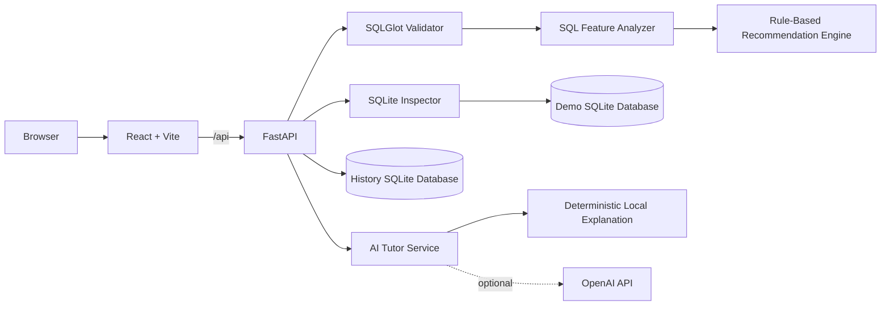

# Index Recommendation Engine

An educational database intelligence laboratory that analyzes SQLite `SELECT` queries, detects indexable query patterns, and produces transparent, rule-based index recommendations. The application combines a React interface, a FastAPI API, SQLGlot parsing, SQLite query plans, interactive visualizations, saved history, and optional AI-assisted explanations.

> The recommendation engine is deterministic. AI explains the engine's output; it does not create, rank, or override index recommendations.

## Purpose

Choosing an index requires understanding query predicates, joins, ordering, grouping, existing indexes, and primary keys. This project makes that reasoning visible for students and developers by:

- validating a safe, single SQLite query;
- extracting index-relevant SQL features;
- inspecting a controlled demonstration schema;
- scoring and explaining candidate indexes;
- rejecting redundant primary-key or already-covered candidates; and
- visualizing query execution concepts and the current SQLite query plan.

The project is a teaching and experimentation tool. It is not a production database advisor or workload benchmark.

## Key Features

- **SQL analysis:** Parses one SQLite `SELECT` statement and extracts tables, equality filters, range filters, join columns, `ORDER BY`, and `GROUP BY` columns.
- **Explainable recommendations:** Returns candidate columns, generated `CREATE INDEX` and reversible `DROP INDEX IF EXISTS` SQL, scores, confidence, reasons, and evidence.
- **Redundancy checks:** Rejects candidates duplicated by a primary key or covered by an existing index's left prefix.
- **Real query-plan inspection:** Runs SQLite `EXPLAIN QUERY PLAN` against the generated demo database.
- **Schema explorer:** Displays tables, columns, primary keys, and indexes discovered through SQLite metadata.
- **Interactive visualizations:** Includes execution flow, table scan, B+ tree traversal, and plan comparison views with playback controls.
- **Analysis history:** Automatically stores completed analyses in a separate SQLite history database and supports viewing, deleting, and clearing entries.
- **Educational AI Tutor:** Explains the current recommendation and answers contextual follow-up questions using an optional OpenAI integration or a deterministic local fallback.
- **Learning modules:** Includes concept reference material, examples, a knowledge test, algorithm and limitation pages, a doubt solver, testing information, AI usage details, and a user manual.
- **Export:** Downloads analysis data as JSON and opens a printable HTML report that can be saved as PDF through the browser.
- **Responsive themes:** Includes dark and light themes with desktop and mobile navigation.

## How It Works

1. The user enters one SQLite `SELECT` query in the Analyze workspace.
2. FastAPI sends the query through SQLGlot validation and normalization.
3. The analyzer resolves aliases and schema-aware column references.
4. Query features are extracted from filters, joins, ordering, and grouping.
5. The rule engine creates and scores single-column and composite candidates.
6. Existing indexes and primary keys are checked to remove redundant candidates.
7. SQLite returns the current `EXPLAIN QUERY PLAN` output.
8. The frontend presents recommendations, rejected candidates, evidence, generated SQL, analysis steps, visualizations, and export controls.
9. The completed result is saved to history. The AI Tutor can then explain the same deterministic result.

## Technology Stack

| Layer | Technologies |
| --- | --- |
| Frontend | React 19, React DOM, Vite, D3, JavaScript, CSS |
| Backend | Python, FastAPI, Uvicorn, Pydantic |
| SQL analysis | SQLGlot with the SQLite dialect |
| Data | SQLite through Python's standard-library `sqlite3` module |
| HTTP and testing | httpx, pytest, pytest-asyncio, FastAPI TestClient |
| Optional AI | OpenAI Chat Completions using `gpt-4o-mini` |

Frontend dependency ranges are declared in `frontend/package.json` and resolved versions are locked in `frontend/package-lock.json`; Python dependencies are listed in `backend/requirements.txt` without version pins.

## System Architecture



Vite proxies `/api` to `http://127.0.0.1:8000` during development. A custom frontend API root can be supplied through `VITE_API_BASE_URL`.

## Project Structure

```text
index-recommendation-engine-core.sync/
|-- README.md
|-- backend/
|   |-- main.py                     # FastAPI application and router registration
|   |-- requirements.txt
|   |-- pytest.ini
|   |-- api/                        # Reserved; currently empty
|   |-- app/
|   |   |-- api/                    # Analysis, history, and AI Tutor routes
|   |   |-- data/
|   |   |   `-- demo_schema.sql     # Four-table demonstration schema
|   |   |-- models/
|   |   |   `-- schemas.py          # Pydantic API contracts
|   |   `-- services/               # Validation, analysis, recommendations,
|   |                               # SQLite inspection, history, and AI logic
|   |-- engine/                     # Reserved; currently empty
|   `-- tests/                       # Backend pytest suite
|-- frontend/
|   |-- index.html
|   |-- package.json
|   |-- package-lock.json
|   |-- vite.config.js
|   `-- src/
|       |-- App.jsx                 # Application shell, navigation, and state
|       |-- api.js                  # Backend client
|       |-- components/             # Analysis and visualization components
|       |-- views/                  # Main application and learning pages
|       `-- styles.css              # Responsive dark/light visual system
|-- database/                       # Reserved; currently empty
|-- docs/                           # Reserved; currently empty
`-- samples/                        # Reserved; currently empty
```

Generated files such as `backend/app/data/index_engine_demo.db` and `backend/app/data/history.db` are created locally and are not source files.

## Requirements

- **Python 3.10+** with `pip` and `venv` (required by the backend's type-annotation syntax). The current project environment was verified with Python 3.12.10.
- **Node.js compatible with Vite 7:** Node.js `20.19+` or `22.12+`.
- **npm** for frontend dependency installation.
- An **OpenAI API key is optional**. The application remains functional without one.

## Setup and Run

Clone or download the repository, then open two terminals from the project root.

### 1. Start the backend

Windows PowerShell:

```powershell
cd backend
python -m venv .venv
.\.venv\Scripts\Activate.ps1
python -m pip install -r requirements.txt
uvicorn main:app --reload
```

macOS or Linux:

```bash
cd backend
python3 -m venv .venv
source .venv/bin/activate
python -m pip install -r requirements.txt
uvicorn main:app --reload
```

The backend runs at `http://127.0.0.1:8000`.

- Health check: `http://127.0.0.1:8000/api/health`
- Interactive API documentation: `http://127.0.0.1:8000/docs`

Optional OpenAI explanations can be enabled before starting Uvicorn:

```powershell
$env:OPENAI_API_KEY="your-key"
```

```bash
export OPENAI_API_KEY="your-key"
```

Do not commit API keys. If the variable is absent or the remote request fails, the Tutor automatically uses its local explanation path.

### 2. Start the frontend

In a second terminal:

```bash
cd frontend
npm ci
npm run dev
```

Open `http://127.0.0.1:5173`.

For a production build:

```bash
cd frontend
npm run build
npm run preview
```

Vite preview defaults to `http://127.0.0.1:4173`. The development server proxies `/api` to the backend, but the preview server does not. For a working preview against the local backend, set `VITE_API_BASE_URL=http://127.0.0.1:8000/api` before `npm run build`, then run `npm run preview`. The backend CORS configuration currently permits frontend origins on port `5173` only, so either preview on that port with `npm run preview -- --port 5173` or update the backend CORS configuration for another deployment origin.

Set `VITE_API_BASE_URL` to the full API prefix before starting or building whenever the API is hosted somewhere other than the development proxy target.

## API Reference

All application endpoints use the `/api` prefix.

| Method | Endpoint | Purpose |
| --- | --- | --- |
| `GET` | `/api/health` | Confirm that the backend is running. |
| `GET` | `/api/schema` | Return demo tables, columns, primary keys, and indexes. |
| `POST` | `/api/sql/validate` | Validate and normalize one SQLite query without executing it. |
| `POST` | `/api/query-plan` | Return SQLite `EXPLAIN QUERY PLAN` steps. |
| `POST` | `/api/recommendations` | Return extracted features, recommendations, and rejected candidates. |
| `GET` | `/api/history` | List up to 100 saved analyses, newest first. |
| `POST` | `/api/history` | Save recommendation and plan payloads. |
| `GET` | `/api/history/{id}` | Retrieve one history entry. |
| `DELETE` | `/api/history/{id}` | Delete one history entry. |
| `DELETE` | `/api/history` | Clear all history entries. |
| `POST` | `/api/explain` | Explain a completed recommendation and query plan. |
| `POST` | `/api/explain/followup` | Answer a question about the current analysis. |

The validation, plan, and recommendation endpoints accept:

```json
{
  "query": "SELECT * FROM orders WHERE customer_id = 42"
}
```

Queries are limited to 20,000 characters. All three endpoints reject empty input, multiple statements, invalid SQLite syntax, and non-query statements with HTTP `422`. The validation endpoint performs syntax and statement-type validation only; the plan and recommendation endpoints also reject unknown or ambiguous columns with HTTP `422` when resolving the query against the demo schema.

## Using the Website

1. Start the backend and frontend, then open the frontend URL.
2. Select **Analyze** and enter a query against the demo schema, or load a supplied example.
3. Run the analysis to inspect candidate scores, evidence, rejected indexes, generated SQL, query-plan steps, and the schema.
4. Use the result tabs to review recommendations, analysis steps, query analysis, or visualizations.
5. Open **AI Tutor** after an analysis for simple and technical explanations or contextual follow-up questions.
6. Use **History** to revisit or remove saved analyses.
7. Use **Learn**, **Practice**, **Examples**, and the pages under **More** for the educational material and project documentation.

The SQL editor is intentionally restricted to one read query. Generated `CREATE INDEX` statements are displayed for study and are not applied to the database.

## Main Pages and Modules

| Page | Implemented purpose |
| --- | --- |
| Home | Concise project introduction, application counts, and navigation calls to action. |
| Analyze | SQL input, examples, schema, recommendations, evidence, analysis steps, plans, and export. |
| Visualize | Execution flow, table scan, B+ tree, and plan comparison experiences. |
| Learn | Searchable and filterable reference for database and indexing concepts. |
| Practice | Knowledge test with progress, answer feedback, and explanations. |
| AI Tutor | Structured explanation and follow-up questions for the latest analysis. |
| Examples | Ready-to-use query examples with educational descriptions. |
| History | Saved analysis browsing, loading, deletion, and clearing. |
| Doubt Solver | Guided concept questions with local or optional AI responses. |
| Algorithm | Explanation of the implemented deterministic recommendation process. |
| Limitations | Honest boundaries of the current engine and visual models. |
| Testing | In-application summary of backend validation scenarios. |
| AI Usage | Explains where AI is used and where deterministic logic remains authoritative. |
| Help / User Manual | Step-by-step application usage guidance. |
| Developed By | Team and project guide credits. |

## Visualization Features

- **Execution Flow:** Animated stages from query submission through validation, parsing, recommendation, planning, and result presentation.
- **Table Scan:** A 12-row D3 educational simulation comparing sequential scanning with direct indexed lookup.
- **B+ Tree:** A conceptual D3 traversal with play, pause, step, reset, and speed controls.
- **Plan Comparison:** Shows the actual current SQLite plan alongside a conceptual proposed-index path.

The table scan and B+ tree do not reproduce SQLite's internal storage pages. The proposed plan does not install an index or run a benchmark; it is deliberately labelled as conceptual.

## Recommendation Algorithm

The engine generates deterministic candidates from SQL structure. Evidence contributes the following scores:

| Evidence | Points |
| --- | ---: |
| Equality filter | 45 |
| Join column | 35 |
| Range filter | 25 |
| `ORDER BY` column | 15 |
| `GROUP BY` column | 15 |
| Composite predicate candidate | 65 |

Scores are capped at 100. Confidence levels are:

- **High:** 65 or above
- **Medium:** 35 to 64
- **Low:** below 35

The engine creates single-column candidates for detected evidence. It also creates composite candidates when a table has multiple equality predicates, or equality predicates followed by the first detected range column. Equality columns are placed before the range column.

A candidate is returned as rejected when it duplicates or extends the table's primary key, or when an existing index's left prefix already covers it. Recommendations are sorted by score and include the exact explanatory evidence used by the engine.

## AI Features

AI is limited to education and explanation:

- With `OPENAI_API_KEY`, the backend requests structured explanations from `gpt-4o-mini` through OpenAI Chat Completions.
- Without a key, or if the request or response fails, the backend constructs a deterministic local explanation from the recommendation and plan payloads.
- Follow-up questions use the same analysis context and have a local pattern-based fallback.
- AI does **not** parse SQL, inspect SQLite, score candidates, generate the authoritative recommendation, or modify the database.
- The system prompt explicitly prevents invented benchmarks and instructs the model not to override the rule engine.

## Database

`backend/app/data/demo_schema.sql` defines four tables:

| Table | Purpose in the demo |
| --- | --- |
| `students` | Student profile, major, and enrollment data. |
| `customers` | Customer identity, region, and join date data. |
| `products` | Product, category, price, and stock data. |
| `orders` | Customer/product relationships, dates, status, quantity, and totals. |

The generated database contains deterministic sample data: 400 students, 800 customers, 120 products, and 5,000 orders. Its baseline indexes are intentionally limited to `students.major`, `products.category`, and `orders.customer_id`, in addition to primary-key and uniqueness support created by SQLite.

The demo database is created lazily at `backend/app/data/index_engine_demo.db`. Analysis history is stored separately at `backend/app/data/history.db`.

## Testing

Run the backend suite from `backend`:

```powershell
.\.venv\Scripts\python.exe -m pytest tests -q
```

Or with an activated environment:

```bash
python -m pytest tests -q
```

Current verified result (elapsed time varies by machine):

```text
76 passed, 1 warning
```

The warning is a Starlette TestClient deprecation notice related to its `httpx` integration. Tests cover SQL validation, destructive-statement rejection, schema inspection, query plans, scoring, composite indexes, existing-index and primary-key rejection, API contracts, history CRUD, and local AI fallback.

The repository currently has no automated frontend unit or end-to-end test suite. The frontend provides `dev`, `build`, and `preview` scripts but no lint or test script.

## Screenshots

Screenshots are not currently stored in the repository. Suggested captures for project documentation:

| Screen | Placeholder |
| --- | --- |
| Home | Add the responsive landing page and animated database pipeline. |
| Analysis | Add a completed recommendation with evidence and query plan. |
| Visualizations | Add the table scan or B+ tree learning view. |
| AI Tutor | Add a structured explanation for a completed analysis. |

## Limitations

- Supports one SQLite query at a time against the included demo schema.
- Does not connect to arbitrary or production databases.
- Does not analyze workload frequency, table statistics, cardinality, data distribution, index size, write amplification, or measured execution time.
- Does not install recommended indexes or benchmark before/after performance.
- Does not generate covering indexes.
- Composite generation uses equality predicates and at most one range predicate; ordering columns are not appended to composites.
- Visual scan, B+ tree, and proposed-plan behavior are educational models rather than exact SQLite internals.
- Generated databases are local application data and are not designed for multi-user deployment.

## Future Scope

- Connect to user-selected databases with controlled, read-only credentials.
- Analyze a workload rather than a single query.
- Incorporate table statistics, selectivity, index storage, and write-cost estimates.
- Add covering-index recommendations and broader composite-index strategies.
- Apply candidate indexes in an isolated sandbox and compare measured query plans and timings.
- Support additional SQL dialects and database engines.
- Add frontend unit, accessibility, and end-to-end tests plus continuous integration.

## Project Team

| Role | Name | Register Number / Designation |
| --- | --- | --- |
| Team Member | Pradnya Lakshmi J R | 25BCE5165 |
| Team Member | Rindhu Anchuri | 25BCE1800 |
| Guided By | Dr. Swaminathan A | Assistant Professor |

## Resources in the Application

- FastAPI exposes generated OpenAPI documentation at `/docs` while the backend is running.
- The **Learn**, **Algorithm**, **Limitations**, **AI Usage**, **Testing**, and **Help / User Manual** pages contain the project's built-in educational and implementation guidance.
- The interface loads DM Sans, Manrope, and Space Mono through Google Fonts.

## License

No license file is currently included in this repository. Add an explicit license before distributing or accepting external contributions under specific reuse terms.
