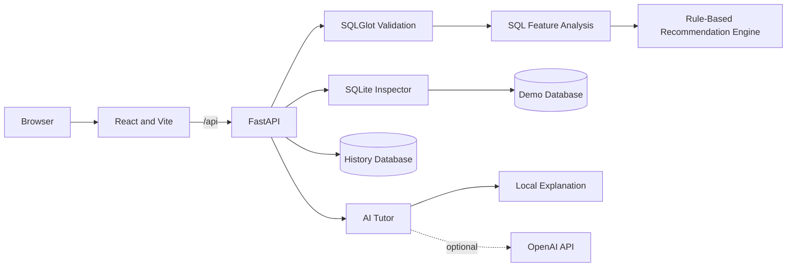

# Architecture

The project is a local web application with a React frontend, a FastAPI backend, and SQLite data stores. The frontend calls the backend through `/api`; during development, Vite proxies those requests to `http://127.0.0.1:8000`.

## Frontend

The React application provides the SQL analysis workspace, schema display, recommendation and query-plan views, interactive D3 visualizations, saved history, educational pages, knowledge testing, AI Tutor, and export controls. Shared state allows a completed analysis to be reused by the visualization and Tutor views.

## Backend

FastAPI registers three route groups:

- Analysis routes validate SQL, inspect the schema, generate recommendations, and return SQLite query plans.
- History routes save, retrieve, delete, and clear completed analyses.
- AI Tutor routes explain the current deterministic result and answer contextual follow-up questions.

The service layer separates SQL validation, feature analysis, recommendation logic, SQLite inspection, history persistence, and educational AI explanations.

## Data

`backend/app/data/demo_schema.sql` defines the controlled SQLite demonstration schema. The demo database is generated locally and inspected through SQLite metadata. Analysis history is stored in a separate local SQLite database.

Generated database files are application data rather than source files. The system analyzes queries against the included schema and does not connect to arbitrary production databases.

## Request Flow

1. The frontend submits a single `SELECT` query.
2. The backend validates and normalizes it with SQLGlot.
3. The analyzer resolves tables and columns and extracts index-relevant features.
4. The recommendation service generates, filters, scores, and ranks candidates.
5. SQLite provides the current `EXPLAIN QUERY PLAN` output.
6. The frontend presents the result and stores the completed analysis in history.
7. The AI Tutor can explain that result without changing the authoritative recommendation.

## Boundaries

- Only one SQLite query is analyzed at a time.
- Recommended indexes are not installed or benchmarked.
- Visualizations are educational models and do not reproduce SQLite storage internals.
- AI is limited to explanations; deterministic application logic remains authoritative.